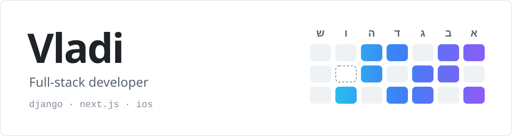

<picture>
  <source media="(prefers-color-scheme: dark)" srcset="banner-dark.svg">
  
</picture>

I build business software end to end: the Django API, the Next.js web app, the native iOS app, and the servers they run on. I'm based in Israel, so Hebrew and right-to-left interfaces are home ground for me, not an afterthought.

## Now building: ManagerAI

**[ManagerAI](https://managerai.co.il)** is a Hebrew-first management system for Israeli businesses. It brings shifts and rostering, attendance, tasks, automations, HR and CRM into one place, with an AI layer that answers questions about your data in Hebrew and transcribes meetings.

Employees and managers also use the iOS app for their shifts, tasks and the company knowledge base.

[Website](https://managerai.co.il) &nbsp;·&nbsp; [App Store](https://apps.apple.com/il/app/managerai/id6777516840)

## Stack

<picture>
  <source media="(prefers-color-scheme: dark)" srcset="https://skillicons.dev/icons?i=python%2Cdjango%2Cpostgres%2Credis%2Cdocker%2Clinux%2Cgit&theme=dark">
  
</picture>
 
<picture>
  <source media="(prefers-color-scheme: dark)" srcset="https://skillicons.dev/icons?i=ts%2Creact%2Cnextjs%2Ctailwind%2Cswift%2Cgithubactions%2Csentry&theme=dark">
  
</picture>

**Backend** &nbsp; Python, Django, Django REST Framework, Celery, PostgreSQL, Redis 
**Web** &nbsp; TypeScript, React, Next.js, Tailwind CSS 
**iOS** &nbsp; Swift, SwiftUI 
**Ops** &nbsp; Docker Compose, Traefik, GitHub Actions, Sentry

## Open source

- [**DjangoNext**](https://github.com/vlabeit/DjangoNext): a production-ready Django 6 + Next.js 16 monorepo template with a DRF API, React 19 frontend, Celery, PostgreSQL, Docker Compose and Traefik. ManagerAI started from it.
- [**webmarket.co.il**](https://github.com/vlabeit/webmarket.co.il): a full Django website with its own design, a dashboard, e-commerce, user accounts and project management.
- [**django-message-rest-api**](https://github.com/vlabeit/django-message-rest-api): a messaging REST API on Django REST Framework with token authentication.

## Get in touch

Write to me through the [ManagerAI contact page](https://managerai.co.il/contact).
